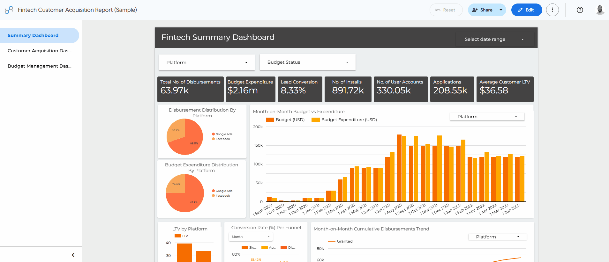
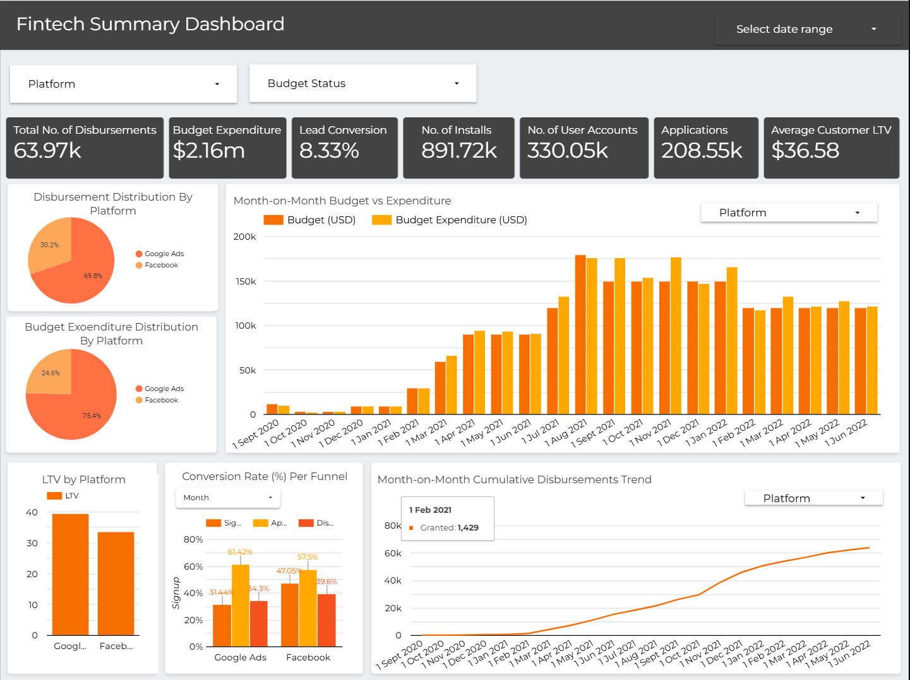
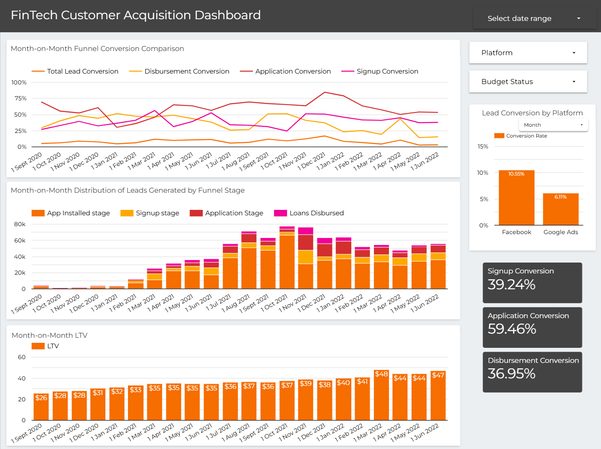
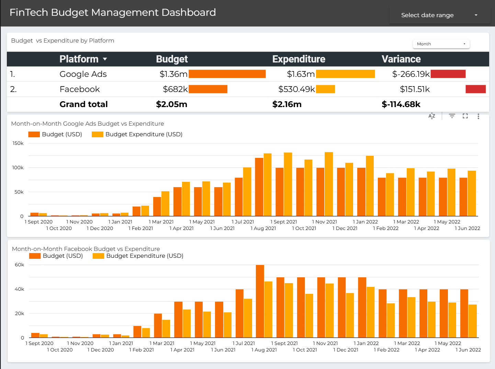

# Marketing Performance & Budget Analytics Dashboard

A marketing analytics case study completed in **2022** using Looker Studio. The project explores paid acquisition performance, budget utilization, customer acquisition funnel conversion, and customer lifetime value (LTV).

The dashboard was developed as part of a recruitment process to demonstrate how business intelligence and data visualization can support marketing performance analysis and decision-making.

## Dashboard Preview

**[View the Interactive Dashboard](https://datastudio.google.com/reporting/df9f3fbd-1a09-4bbe-9eb9-3a30efef06ef/page/ZoC7C)**



*The GIF provides a walkthrough of the report's three pages.*

> **Data-sharing notice:** The original dataset was provided for a recruitment exercise and is not authorized for redistribution. The CSV is therefore excluded from this repository. The dashboard link and visual assets should only be published after confirming that the applicable sharing restrictions permit public access.

## Project Overview

The dashboard analyzes marketing performance across Google Ads and Facebook, with a focus on the relationship between advertising expenditure, acquisition volume, conversion outcomes, and customer value.

The project was designed to help answer questions such as:

- How does actual marketing expenditure compare with the allocated budget?
- Which acquisition channel generates more recorded outcomes?
- How do users progress through the acquisition funnel?
- How efficiently does each channel convert advertising expenditure into installations and granted outcomes?
- What additional data would help explain changes in acquisition performance and customer lifetime value?

## Tools & Technologies

- **Looker Studio:** Interactive dashboards, data visualization, and calculated fields.
- **CSV:** Source data format supplied for the case study.
- **Business intelligence:** KPI monitoring, funnel analysis, budget variance analysis, and performance comparisons.

## Dashboard Pages

### 1. Summary Dashboard



Provides a high-level view of marketing performance across platforms and reporting periods.

The page is intended to help stakeholders assess overall performance and identify areas that warrant further investigation.

### 2. Customer Acquisition Dashboard



Examines the acquisition funnel across four stages:

**First-time Installs → Signups → First Applications → Granted Outcomes**

The analysis compares funnel-stage conversion between Google Ads and Facebook, helping identify where the largest proportional differences occur.

### 3. Budget Management Dashboard



Focuses on allocated budget, actual expenditure, and acquisition efficiency.

The analysis compares budget against spend and examines expenditure relative to installations and granted outcomes.

## Dataset Overview

The original CSV contained the following fields:

| Field | Description |
|---|---|
| `Month` | Reporting month |
| `Year` | Reporting year |
| `Platform` | Marketing acquisition platform |
| `Budget (k USD)` | Allocated budget in thousands of US dollars |
| `Budget Spent (k USD)` | Actual expenditure in thousands of US dollars |
| `1st time installs` | Number of first-time installations |
| `Signup` | Number of signups |
| `1st Applied` | Number of first applications |
| `Granted` | Number of granted outcomes, interpreted as loan disbursements in the original case study |
| `LTV` | Customer lifetime value metric; the exact definition and aggregation level should be confirmed |

The source dataset is not included because redistribution permission was not granted. No raw data extracts should be committed to this repository.

## Calculated Fields

The following calculated fields were created in Looker Studio.

| Calculated Field | Formula | Purpose |
|---|---|---|
| `Budget (USD)` | `Budget (k USD) * 1000` | Converts allocated budget to USD |
| `Budget Spent (USD)` | `Budget Spent (k USD) * 1000` | Converts actual expenditure to USD |
| `Budget Spend/Client` | `Budget Spent (USD) / Granted` | Calculates spend per recorded granted outcome |
| `Reach/Budget Spend (Installations/$)` | `1st time installs / Budget Spent (USD)` | Calculates installations per dollar spent |
| `Conversion Rate` | `Granted / 1st Applied` | Calculates first-application-to-granted conversion |

See [`docs/calculated-fields.md`](docs/calculated-fields.md) for further details and interpretation considerations.

**Metric clarification:** `Budget Spend/Client` uses granted outcomes as its denominator. Unless each granted outcome represents a unique customer, this should not automatically be interpreted as customer acquisition cost (CAC). Similarly, installations per dollar spent measures installation efficiency, not advertising reach in the conventional sense.

## Key Findings from the Original Case Study

The following findings were recorded in my original 2022 analysis. They are presented as historical findings and have not been independently recalculated for this repository.

### 1. Budget utilization

- Google Ads expenditure was reported to exceed its allocated budget.
- Facebook expenditure was reported to be below its allocated budget.
- Overspending was reported in all months except September 2020, October 2020, February 2021, August 2021, December 2021, and February 2022.

These observations highlighted the importance of monitoring budget variance by platform and reporting period.

### 2. Acquisition channel performance

- Google Ads was reported to perform better in terms of sales or loan disbursement volume and LTV.
- Facebook was reported to have a higher conversion rate from leads to granted outcomes.

This illustrates why acquisition volume and conversion efficiency should be evaluated together rather than using a single metric to judge channel performance.

### 3. December 2021 acquisition funnel

The original analysis reported the following stage-to-stage conversion rates:

| Funnel Stage | Google Ads | Facebook |
|---|---:|---:|
| First-time installs - Signups | 41.15% | 60.37% |
| Signups - First applications | 84.15% | 84.82% |
| First applications - Granted outcomes | 25.85% | 48.65% |

Facebook recorded higher reported conversion rates at all three stages in this historical comparison.

These values are transcribed from the original case-study answers and should be checked against the dashboard before being treated as verified results.

### 4. Budget allocation as a hypothesis

The original analysis proposed that differences in budget allocation might help explain the performance gap between Google Ads and Facebook.

However, this was a hypothesis rather than a demonstrated causal relationship. Audience characteristics, campaign design, targeting, platform attribution, customer eligibility, seasonality, and other factors could also have influenced the results.

## Further Analysis Proposed

Beyond dashboard reporting, the original case study identified several areas for deeper investigation.

### Customer acquisition and product usage

Customer-level data could help identify unique customers, account duplication, and the relationship between usage of different product lines, such as microloans and savings.

### Loan performance and repeat usage

Loan-level data could help investigate repeat borrowing, loan amounts, loan tenure, interest rates, repayment structures, and the time between application and disbursement.

### Customer experience and retention

Customer surveys and appropriately collected feedback could help investigate customer satisfaction, support quality, product suitability, and potential reasons for declining retention or lifetime value.

### Campaign and market performance

Campaign-level data—including impressions, clicks, audience settings, creative history, and spend—could help investigate changes in click-through rate (CTR) and acquisition efficiency. Competitor and market information could provide additional context.

These are proposed analytical directions, not conclusions established by the available dataset.

## Limitations

- The original CSV is not included, so the historical analysis cannot be reproduced from this repository alone.
- The project reflects a recruitment case study completed in 2022 and does not represent current marketing performance.
- The precise definition and aggregation level of LTV require confirmation.
- Funnel ratios should be interpreted carefully if counts do not represent aligned customer cohorts or reporting periods.
- Observed differences between acquisition channels do not establish causality.
- The available fields do not include impressions or clicks, so CTR cannot be calculated from the listed dataset alone.

## Potential Improvements

If I were revisiting the project today, I would consider:

- Adding year-over-year performance comparisons.
- Validating funnel metrics against aligned cohorts and consistent attribution rules.
- Comparing acquisition cost with customer lifetime value where definitions and data permit.
- Incorporating campaign-level metrics to investigate CTR and creative performance.
- Using pseudonymized customer-level data to analyze retention and repeat borrowing.
- Adding data-quality checks and documenting metric definitions more explicitly.

## Repository Structure

```text
looker-studio-marketing-analytics/
├── README.md
├── .gitignore
├── assets/
│   ├── dashboard-demo.gif
│   ├── summary-dashboard.png
│   ├── customer-acquisition-dashboard.png
│   └── budget-management-dashboard.png
└── docs/
    ├── calculated-fields.md
    ├── methodology.md
    └── publication-checklist.md
```

## Author

**Uchenna Nwachukwu, MSc**

Data & Operations | Business Intelligence | Analytics

[Connect with me on LinkedIn](https://www.linkedin.com/in/davuche/)

---

*Historical recruitment case study completed in 2022. Shared for portfolio and learning purposes, subject to applicable confidentiality and data-sharing restrictions.*
